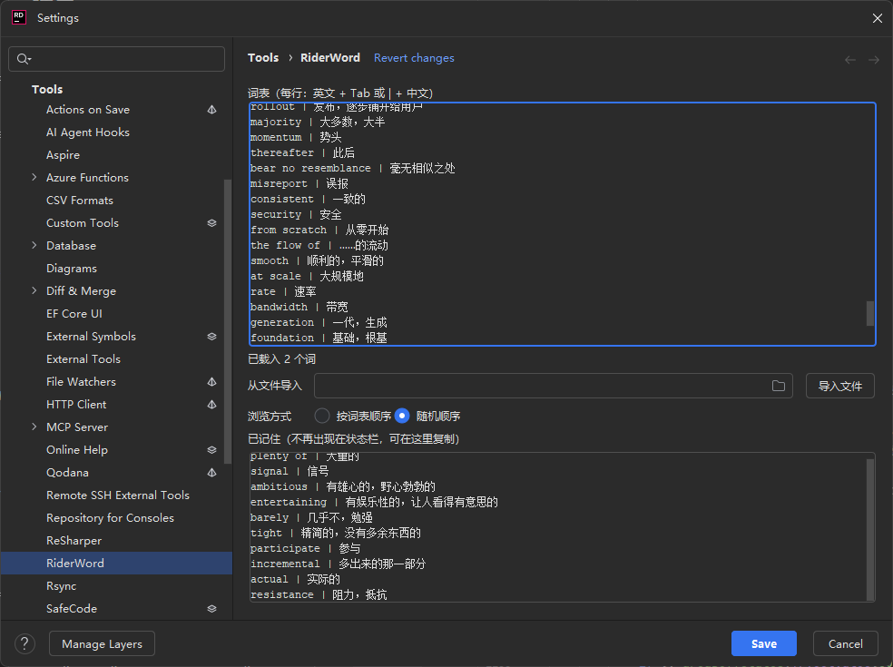

# RWord

在 JetBrains Rider 状态栏学习英语的轻量插件，支持自定义中英词表和句子、离线发音、随机浏览和已记住单词管理。

最左侧是 `Word` / `Sentence`，用来切换单词和句子。单词模式下：Auto、上一个、当前词、下一个、`EN+`、`Got`、进度、`Copy`。句子模式隐藏 `Got`，最右侧 `Copy` 复制当前英文；句子超出宽度时，拖动或滚轮横向滑动。点击英文发音。`Got` 经确认后标记已记住，返回上一个后可用 `Undo` 恢复。

## 使用

Settings → RWord：

- 词表每行一个词，`英文<Tab>中文` 或 `英文 | 中文`
- 也可以选择 `.txt` / `.csv` 文件后点“导入文件”
- 浏览方式可选“按词表顺序”或“随机顺序”（只作用于词表）
- 句子：英文在上，中文在下，两组之间空一行。多行会并成一行。句子按粘贴顺序浏览，不随机，也不能标记已记住

空行在词表里会被忽略；在句子里，空行用来分开两组。格式不对的会被跳过并计数，重复的英文（忽略大小写）保留第一次出现的写法。
当前词、当前句和随机顺序会记住，重新打开 Rider 后从上次的位置继续。

发音使用 Windows 自带的英文语音，不联网。其他系统上发音会提示不可用，浏览不受影响。

## 界面

设置页维护词表、导入文件，并查看已记住的词：



状态栏从左到右是 `Word`/`Sentence`、自动朗读、上一个、当前内容、下一个、中英显示、记住（仅单词）、进度和最右侧的 `Copy`：


## 构建

需要 Rider 2026.2 自带的 JBR（Java 25），不需要 Gradle。

```bash
RIDER="C:/Program Files/JetBrains/JetBrains Rider 2026.2.0.2"
CP=$(find "$RIDER/lib" -name "*.jar" | tr '\n' ';')
CLASSPATH="$CP" "$RIDER/jbr/bin/javac.exe" --release 25 -encoding UTF-8 -d classes $(find src -name "*.java")
```

然后把 `classes` 和 `src/META-INF/plugin.xml` 打成
`RWord/lib/rider-word.jar`，再整体压成 zip。成品在 `dist/RWord.zip`。

自检：

```bash
python build/run-tooltip-check.py
```

## 安装

Settings → Plugins → 齿轮 → Install Plugin from Disk，选择 `dist/RWord-0.1.1-signed.zip`，重启 Rider。
仅适用于 Rider 2026.2。
